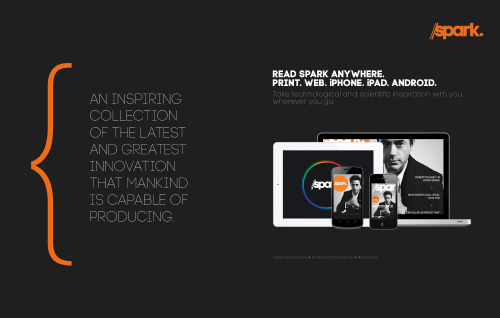

I took into consideration the points Mary had made when discussing the magazine’s new logo. It was suggested that it did not seem techy enough for the type of magazine it was describing. I decided to look into some themes that I could bring into the design of the logo and also the content of the magazine.

After some research I came across an interesting concept when looking at code. Code is basically what makes up so many things we use in modern life from its application in computer science and technology. I looked at the use of punctuation in the code such as // and { and . which mean certain things such as comments and the beginning or end of declarations.

Another one of the points Mary made was that the spacing between the letters needed to be take away as it was for the S, P and A, however I feel that because of their width, having the R and K that close together made the word feel awkwardly condensed at that end, so I retained the gap. The other problem was removing the gaps there was that it looked like the magazine was called ‘Spank’.

I decided to take the // and apply it to the beginning of certain elements such as the logo but also for the beginnings of important parts of copy or something that should be taken notice of. I also used the concept of the { to begin the magazine, so there is a very large one on the first page showing it is the beginning of the magazine and also there would be a closing } at the end of the magazine to show the content has finished.

I feel that these design elements have successfully added a subtle but unique approach to making the magazine feel techy, as opposed to a straight forward ‘stylish magazine’, I will explore some more design concepts further to see what else I can do to improve the overall design of the content for the magazine.
