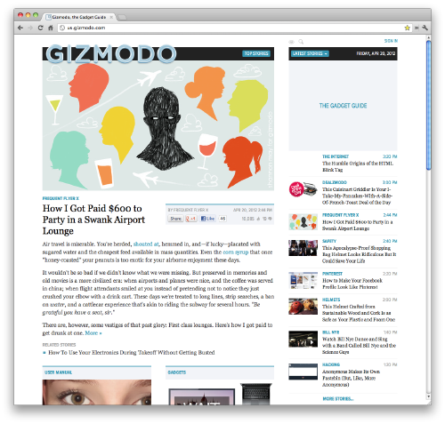
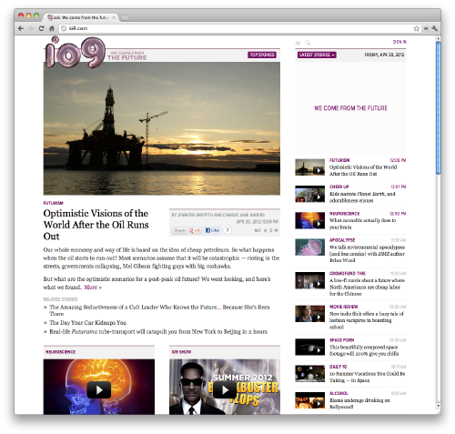

In order to find some good articles that I could use for my magazine redesign, and that were also relevant to the magazine itself, I decided to look at some website I like to visit. I already knew that Spark was a magazine that was much like a combination of a few websites I frequently go to, and because the subjects they cover are similar it was easily to choose some articles that fit very well with my chosen magazine.

I looked at two Gawker Media blogs, [Gizmodo](http://us.gizmodo.com/) and [io9](http://blog.io9.com/). The former is a technology and gadget blog which I sought after some good reviews for as Spark magazine has gadget reviews. The latter is a science and sci-fi/fantasy blog, with some very good articles covering the latest in the scientific and also technology world. And finally, a website called [Uncrate](http://uncrate.com/), this had some good inspiration for products that could be featured as it covers a wide variety of things from cars, clothes, bloats, architecture to gadgets which was a good place to start when thinking about what to feature for my articles.

After searching for relevant articles I then went through them and edited them to fit within the page restrictions of either a long article of five pages, or a short article of 2 pages. I could them choose which was the best of a selection of articles I had found based on the quality of images I could find for each one. For example, I chose up to 5 articles, however finding large high resolution photography proved very difficult and so I could only choose the article with the best images.

I did email a few organisations and websites regarding using high resolution images, stating my situation, however as of yet, I have had no replies. I will wait for a while before I finalise everything as I could find some better images for an article that I like better than the ones I have initially chosen. I feel that photography and imagery should play a vital role in the magazine’s design, for the redesign I want to try to stay away from using very small images as they are often useless space fillers. If there is going to be any imagery, I want it to come to the forefront and be a crucial element in the magazine’s redesign.

**Articles I have chosen for the magazine:**

[Canon 5D Mark III Review](http://gizmodo.com/5895239/canon-eos-5d-mark-iii-review-the-best-dslr-for-shooting-video)  
[The Asteroid that Killed the Dinosaurs](http://io9.com/5902072/the-asteroid-that-killed-the-dinosaurs-might-have-created-life-in-other-solar-systems?tag=biology)  
[How to Build a Dyson Sphere](http://io9.com/5902205/how-to-build-a-dyson-sphere-in-five-relatively-easy-steps?tag=futurism)  
[Robots will Steal Your Job](http://io9.com/5885512/robots-will-steal-your-job-but-thats-okay-how-to-survive-the-coming-economic-collapse?tag=futurism)  
[Stellar Nursery](http://io9.com/5902664/the-most-detailed-picture-yet-of-a-star-nursery-birthing-new-suns)
