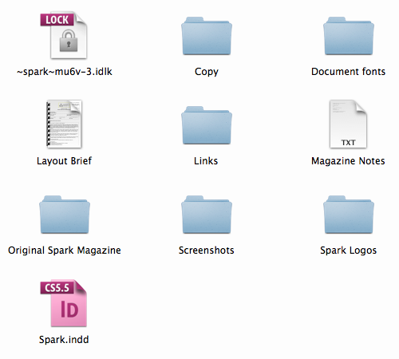
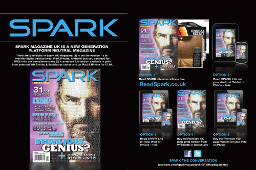
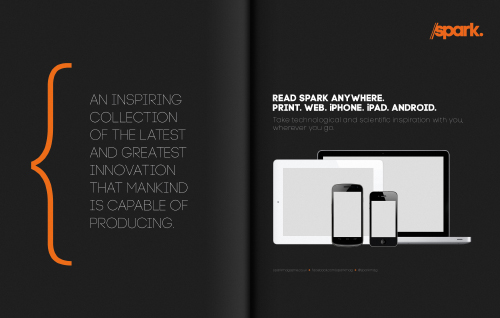

After a while of placing everything I had gathered into InDesign and begun properly designing the magazine, I then proceeded to make a package so that everything was together in a single file directory. This would then make things easier for later as I add images I can simply put them all in the Links folder. This process also gathered up all the files I had placed onto the pasteboard so I had copies of them in said directory making finding things for later much easer.

I first started off with the very first pages of the Spark magazine which were the inside of the cover, these showed the different ways to read Spark. I felt this page could use some serious redesigning and it would also be a good place to set the tone for the design. I was free to experiment with elements so that I could the filter those down into the subsequent pages.

One of themes I wanted to carry on from the logo, was the concept of using punctuation which is often used in programming. I started by giving the first page that featured content an open curly bracket, defining the content of the magazine starts here, and at the very last page there would be a closed curly bracket. I also wanted to use other pieces of punctuation and symbols throughout the magazine like with the cover to give a consistent theme.

I have take the information from the original pages, reduced it to the minimum required to convey the message without it getting unnecessarily long, and I have even included the quote which explains the magazine’s entire objective. I felt this was a very important element which should be displayed in a prominent location in every issue, and not hidden away in the welcome message of the very first issue.

I also reduced the clutter into a more easily digestible layout, showing an array of devices together instead of showing each one individually with the exact same message beneath each one, which I felt wasn’t needed. It was mostly self explanatory and I feel the message is conveyed better for people to quickly process as they flick through the pages since it’s an important message, considering the digital versions of the magazine would probably make up a considerable portion of their revenue.
