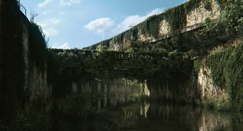
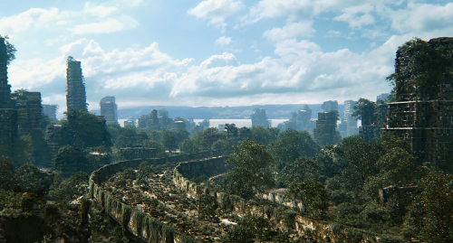
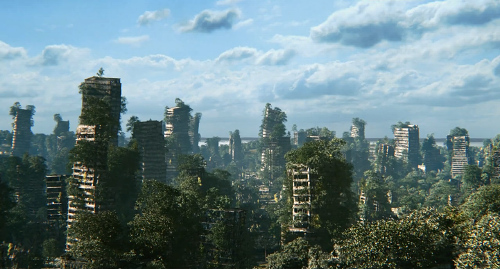
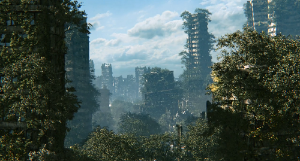
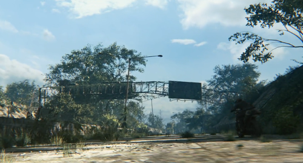
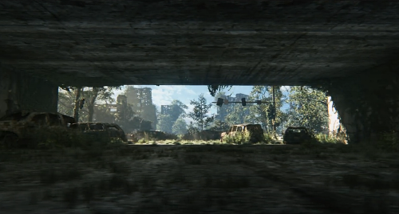
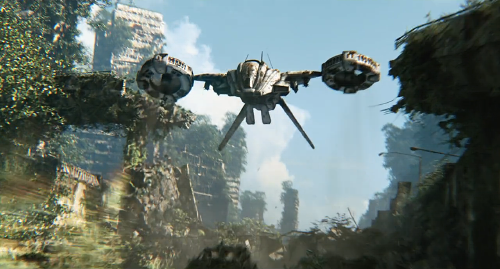
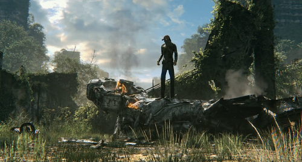

While trying to up with ideas I suddenly remembered a short film I had seen a while back that I decided to watch. After watching it I had an epiphany and changed my idea. I was suddenly inspired to create something that would take on a similar look and feel to the Ruin short that I had watched.

<a class="video-embed" data-provider="vimeo" data-id="38591304" href="https://vimeo.com/38591304">Play video</a>

  
For a long time now the concept of seeing modern day cities engulfed in foliage was fascinating to me and I now wanted to create something I now had ideas for in my head. In order to get a good sense of where I should go with my piece I analysed the visuals of the film to determine some key elements that I could work into my matte painting.

First of all the thing that struck the most was the general atmosphere. It was not dark and gloomy or depressing, but instead very sunny and hot. This alongside the prominence of trees and plants made the world feel lush and full of life in a strange way, because there was also the contrasting sense that it is a lonely quiet world with not a lot of people.

I want to try and bring these feelings across in my piece so I looked closer at the scenes of the short film to see what else caught my attention. I looked at some of the physical attributions of the world in how buildings and roads would behave with plants invading them, such as the physical properties of structures and how that would change with roots and erosion from the vast time they had spent with no maintenance.

I had to consider that so many trees would weaken fragile concrete structures to the point where they are cracking and breaking in key parts. Plant roots would also play hovok on road surfaces and there would be weeds growing out of all these crevices. In the film there are a lot of instances of buildings bending and buckling appearing to be leaning over in certain directions with trees growing out of the floors.

There is also a lot of bent and rusted metal present such as sagging road signs and poles that stick out from the ground that give an atmosphere of being in the far future and these objects made to last have all but disintegrated away in a time where they haven’t been used. Another feature are rusted cars stripped of their paint and metallic shine that have melded to the ground and have plant life growing around them. This is also something I’d like to look at.

Additionally I really like how there are broken overpasses which have disintegrated showing the underlying beams holing them together. I feel this is something I could recreate to show that the environment is slowly breaking up and eroding as time goes on.

I feel that watching this video has really helped me with my idea of what I want to accomplish and it has given me a firm base of which to start some more research into the concept and matte paintings. This is an area I’m greatly interested in and I’m glad I finally have a reason and purpose to properly explore it.
