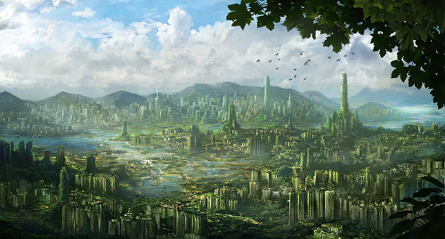
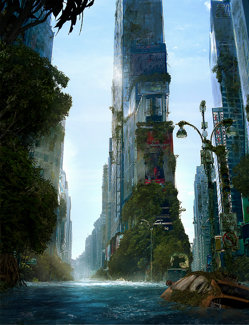
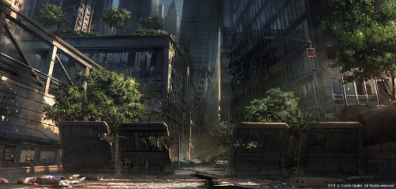
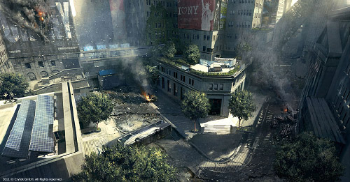
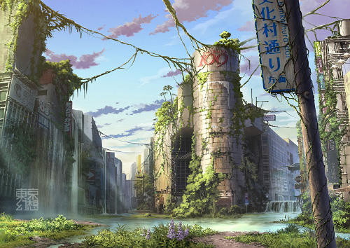

After I knew what it was I wanted to do I now could quickly look through all of my favourites on deviantART that I have gathered up specifically focusing on city ruins with foliage as I could easily pick up ideas from each different piece. Looking at other people’s work got the considering how I would compose my scene.

For instance there were many different composition ranging from distant city shots, to close ups of specific focal points and depictions of entire streets. I also looked at some other things that were particularly related to ruins of cities but instead use plants in their work so I can pick up cues on how to handle the blending of the photography of plants into other elements in the composition.

