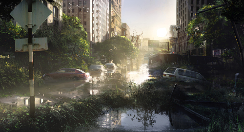
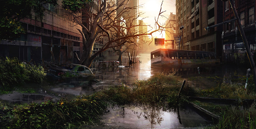
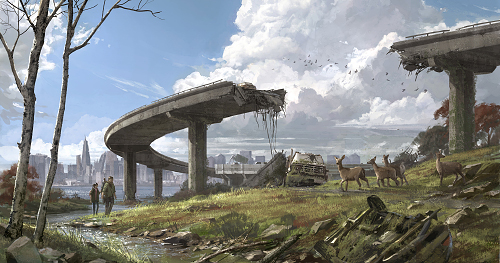
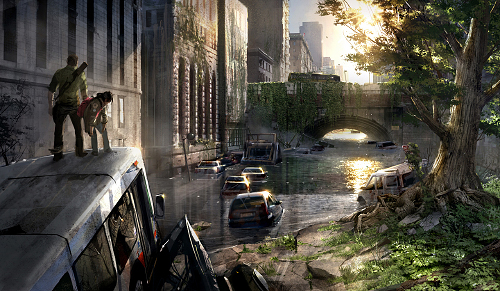
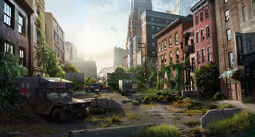

Another source of influence I came across was the concept art for the game The Last of Us, set in a post-apocalyptic word among the ruins of our modern world. I began to look at the different environments I could try such as having flooded roads with cars roof tops slightly above the water.

This concept would be rather challenging as I would need to find a lot of elements at a specific perspective depending on the original base image I would use. There would also be a lot of potential for having some fun with the water line and what I could place in the water, etc. I feel that could be an interesting direction to take my piece.

Another thing I noticed about these is the atmosphere, it’s either very sun-setty or rather bright, a reoccurring theme I’m seeing with these post apocalyptic scenes that I’ve been looking at. I will need to take into careful consideration the atmosphere for my piece as I want it to convey a very bright and hot day and the viewers can almost hear the abundance of birds in the scene.

One thing that really strikes me about this concept art is the very delicate highlights form the sun on objects, it adds a heightened level of realism and makes the scene really come to life as opposed to something with a rather muted and flat colour palette. And again, I’m noticing the large quantity of hanging ivy and vines on bridges and walls, and the vegetation grown out of cracks in the concrete, something I will be sure to include in my final piece.
