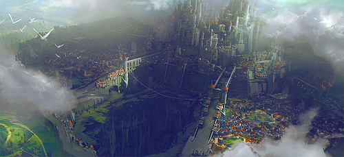
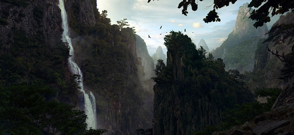
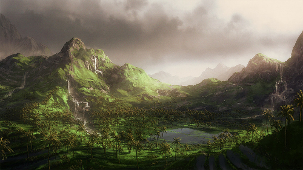

My initial ideas so far for my 3D project are that I’d like to explore either something like what I had looked at earlier, the very clean renders of objects and architectural scenes. I like the style and of works like that however I feel that my experience doesn’t offer a good opportunity to pull something like that off that would look good enough to be considered part of that style.

My other idea was to create a fantasy based scene with mountains and some sort of monuments or buildings. I looked back over my previous inspiration that I’d done and looked at some of the matte paintings that caught my attention, mostly pieces that were based in the fantasy genre. Here are a few that I looked at:

I feel more inclined to go down the fantasy landscape scene route more than the architectural style of 3D renderings. This is mostly because I feel more comfortable with landscapes as my previous project was a landscape. I want to explore the techniques that I attempted to use first time round and improve on them instead of going in a totally different directs and starting off with no experience in the subject at all.
