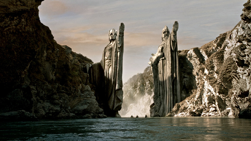
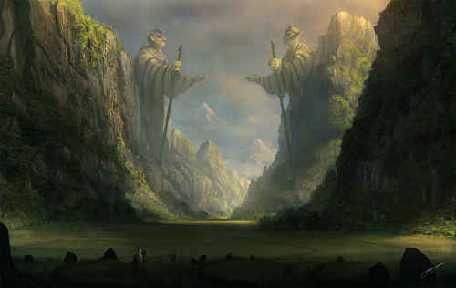
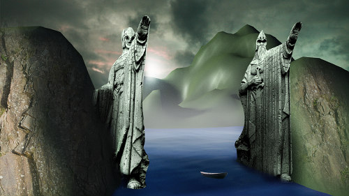

Now that I have a better idea of what I want to do I started some research and gathered a few pieces of work for inspiration. I was looking closely at the Gates of Argonath from Lord of the Rings. I would like to somehow recreate a similar scene perhaps involving two mountains to the sides of the frame with two large rock statues at the edges of those mountains with body of water in the centre, leading off to a mountainous landscape in the background.

I had started forming the general shape of the land in Houdini as I was going to get a head start on the sculpting of my environments before settling on a specific point of interest. Having humanoid statues in my piece will also be interesting as it would give me the opportunity to look at box modelling a human shape as well as the landscape.

