I’ve been looking at a few CV designs, mostly found on Behance as there was a lot of variation and interesting designs that caught my eye. It became clear very soon that since a CV is a very personal thing for someone to design I often found them filled with all kinds of styles and they were usually very busy looking, almost as though the designer, most probably rather new to the field would jumble everything they like into one small document.

This made finding CV designs I genuinely liked, however I found a number that included aspects I thought were notable and had elements I could see myself incorporating into my own. The designs I became most drawn to either had a very strong personal touch that had been successfully implemented or designs with a minimalist and solid layout, utilising an apparet grid or ones with interesting quirks.

**Edward Togu**

I was drawn to this design due to the solid layout and I liked how they have given their skills a star system to show how proficient they are at each skill. Visualising this kind of information is something I see take on different styles throughout my search which will be evident in my selection.

[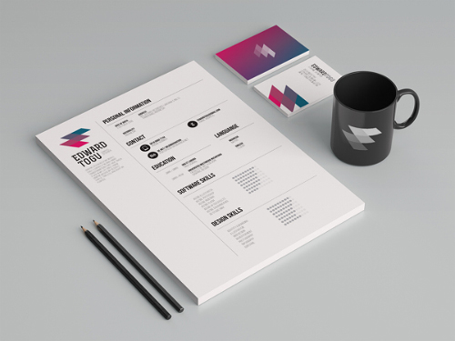](http://www.behance.net/gallery/Self-Promo/5220471)

I also liked how the visual styling of their self promotional arsenal is consisten throughout, this is obviously something that will be crucial as it would show that not much through has been put into my image if the various documents I had out to people all convey different design styles.

**Joshua Yap**

This is a very cool CV in my opinion, it features a strong cover that immediately conveys what this person does, their style and effectively brings across their personality and humor. Being able to do this will be difficult to get right as with a lot of other CVs I saw generally came across as being obnoxious or a bit to ‘try-hard’, however this is, I think a great example of giving potential employers a good insight into the person behind the CV.

[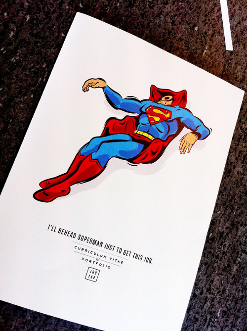](http://www.behance.net/gallery/CURRICULUM-VITAE/3587067)

I also quite like how the contents is laid out, in a kind of retro way, using clear headings and very straight to the point points under each topic. It has as good and unique flow to it that shows the information in a hierarchy so that it’s easy to skim over and get a good sense of what they want to tell the reader.

[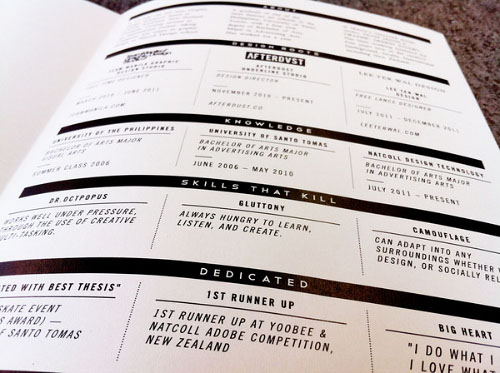](http://www.behance.net/gallery/CURRICULUM-VITAE/3587067)

[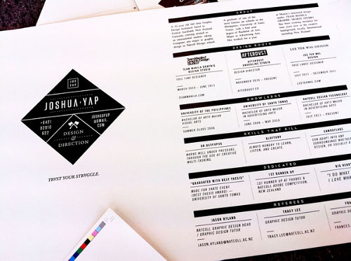](http://www.behance.net/gallery/CURRICULUM-VITAE/3587067)

The design has a great choice of typography and effective use of space, it doesn’t feel overwhelming even though there ins’t much blank space like in more traditional CVs, so I think it is an overal creative and interesting solution to making a personal promotional vehicle for them. Thier Behance project also contains a few good tips on creating a CV such as:

> Tired of not getting any feedbacks from all the places you’ve tried to apply work? Here’s a good tip, Stop typing “Curriculum Vitae Samples” in google and try to make a CV that will actually make them say WTF.

And “Get outside of the box, If you fail. At least you tried.”, great stuff.

**Genevieve Dennis**

Next up. A design with some good ways of visualising data, like previously discussed, this one shows a good use of graphs to get across time scales in their experience and education and graphs to show how good they are in certain skill-sets. I am sometimes in the middle on these kinds of things as sometimes they usually don’t offer any relevance and feel vague.

[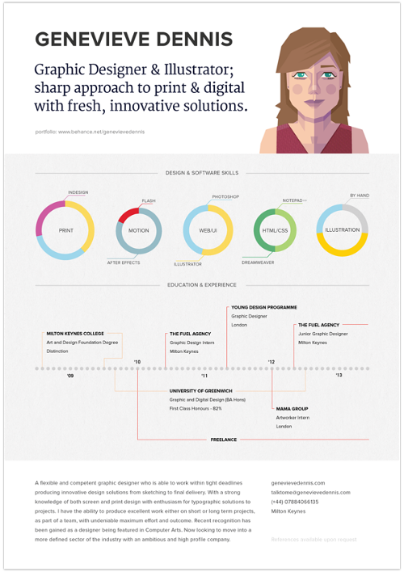](http://www.behance.net/gallery/Resume-Curriculum-Vitae/4394653)

However with this design in particular they have divided each skill into a specific application of the skill, such as print or motion so that it’s easy to gauge the measurement of each skill in a context. So if I am to go down this route I will need to be aware of how I display information like this as I don’t want to use graphic visualisation for the sake of it. I will need to make sure it isn’t vague and offers a clear and concise alternative to any other solution.

[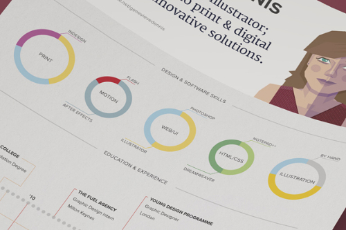](http://www.behance.net/gallery/Resume-Curriculum-Vitae/4394653)

[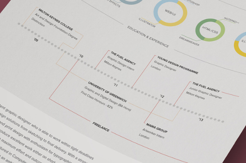](http://www.behance.net/gallery/Resume-Curriculum-Vitae/4394653)

Again, instead of a list with dates they have used a visual form of showing when the events have taken place so that it can be digested at a glance, very important if the person reading will only be glancing for a few fleeting moments.

**Ashley Spencer**

I was interested by the form this design takes, a small booklet, is an interesting concept, especially with the phrase used and the clever way you would need to remove the card to reveal what is something that will catch the readers attention.

[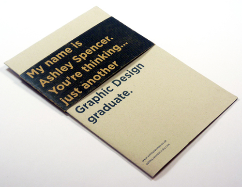](http://www.behance.net/gallery/Curriculum-Vitae-Resume/3740015)

[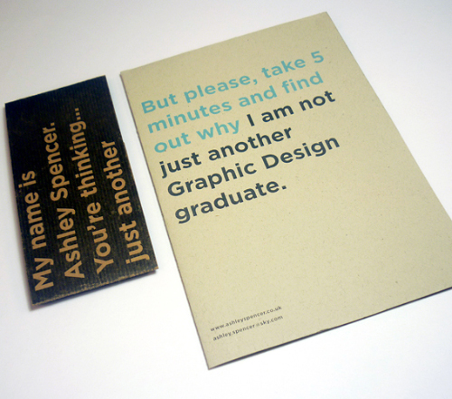](http://www.behance.net/gallery/Curriculum-Vitae-Resume/3740015)

[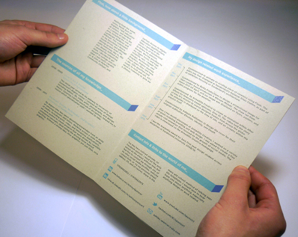](http://www.behance.net/gallery/Curriculum-Vitae-Resume/3740015)

I like the thought that clearly went into how it is presented physically, not just the layout or typography, but the paper, the process of opening it up and how that has a slight interactivity to it. I would certainly want to think about how my CV is printing and how it would look and feel to the reader, and how that can make it stand out from all the other CVs.

**Ross Sweetmore**

This is another design that has taken into consideration the process of opening it as it appears to come in an envelope and needs to be unfolded. I rather like this kind of presentation. It has a personal touch with the signature style logo and with period style typography conveying some good design and presentation skills.

[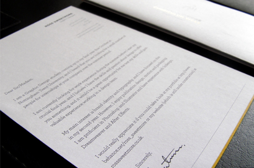](http://www.behance.net/gallery/Self-Promotion/4395163)

I particularly like the typographic elements in this example as it gives the sense of being an old document typed away on a typewriter, but with some contemporary design cues, it has a good overal look to it.

[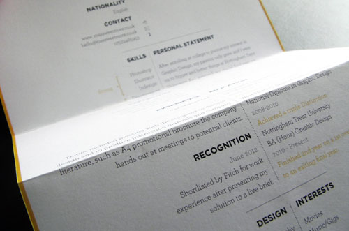](http://www.behance.net/gallery/Self-Promotion/4395163)

The information is clearly laid out with a central column splitting the information down the middle and the elongated paper makes it look unique without being overly loud and feels very clean and minimal with a well chosen highlight colour scheme.

[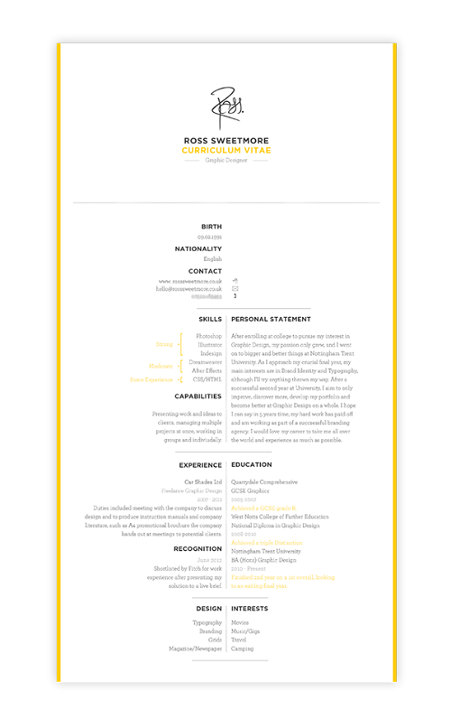](http://www.behance.net/gallery/Self-Promotion/4395163)

I really think looking at a lot of different CV designs has helped me significantly. Especially since I will need to make something that will stand out among the many hundreds, of not thousands of CVs employers would be sifting through. It clearly pays to be different and show your personality so their can get a sense of whether or not they want to take the process further. I definitely gained some ideas of where to go with my own CV from this research.
