I have been researching a few directions I could take my rebrand and looking at the positives and negatives of each one to come to a conclusion on what would best suit both my skills and would serve as something commercially viable that I improve my experience in the banding field.

First of all I needed to look around at places that either interested me or looked as though they were out of date and could use with refreshing their image in order to better communicate with their audience. I began my research in technology brands as this is of great interest of me being a big fan of technology and gadgets.

A lot of the major tech brands are already doing very well in terms of portraying their image and had a solid foothold in their market, such as Samsung, Asus and Sony. Inspired by the company Vizio in America, a ‘cheap brand’ for TVs sold in WalMart, recently had a major overhaul of their image and the products they produce taking in a lot of influence from Apple and becoming a brand now associated with high quality laptops and desktop computers.

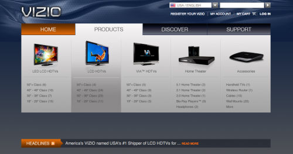

Vizio Before their Rebrand

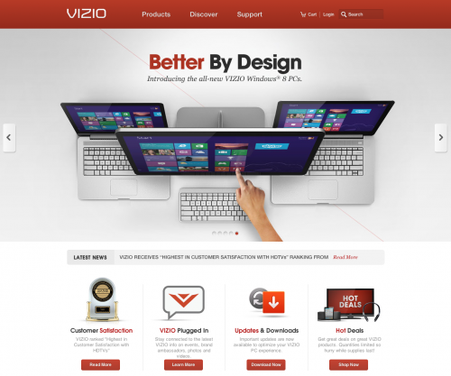

Vizio After their Rebrand

I decided to look at some of the brands that were big a few years ago but are now relatively over-looked in todays tech market, such as Toshiba who were one of the major players in the late 90′s but are now hardly the first choice for home electronics in todays market dominated by the current big leaders. Another company I looked into was Archos who in a time before the iPad were one of the only companies exploring hand held devices for multimedia consumption but are now not much more than a footnote producing Android tablets that have never really impacted the market like Amazon’s Kindle Fire or Google’s Nexus 7 has.

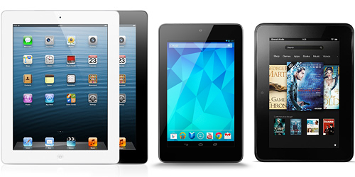

 The iPad, Google Nexus 7 and Amazon’s Kindle Fire

I believe these are prime targets for rebrand and product line overhaul. There would be plenty of opportunity to product advertising campaign material, editorial design, corporate documents and branding, however there are some major drawbacks. I would need to design and produce products for these companies as that would be a major part of the rebrand. This means making 3D representations of concept products that I could put into the branding and advertising material and websites.

If I can find a way of doing this then this would be my project of choice as there is a lot I could do with their brand images but it seems unlikely I will be able to as I’m not very experienced with 3D software and it may turn out to be too much effort in producing what is essentially a proof of concept in terms of graphic design.

[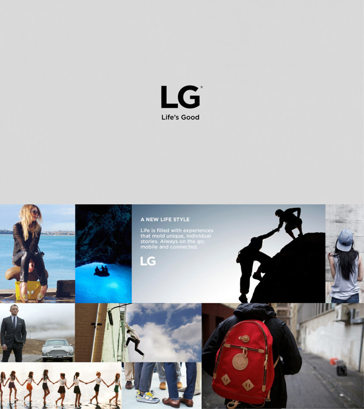](http://www.behance.net/gallery/LG-Define/6148491)

[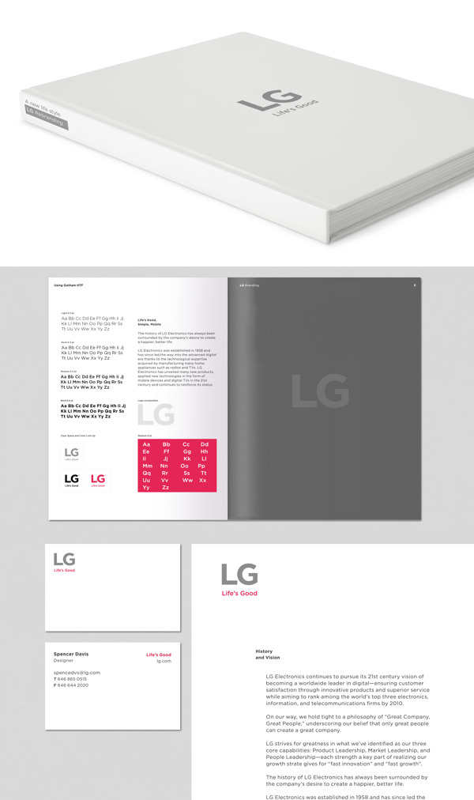](http://www.behance.net/gallery/LG-Define/6148491)

[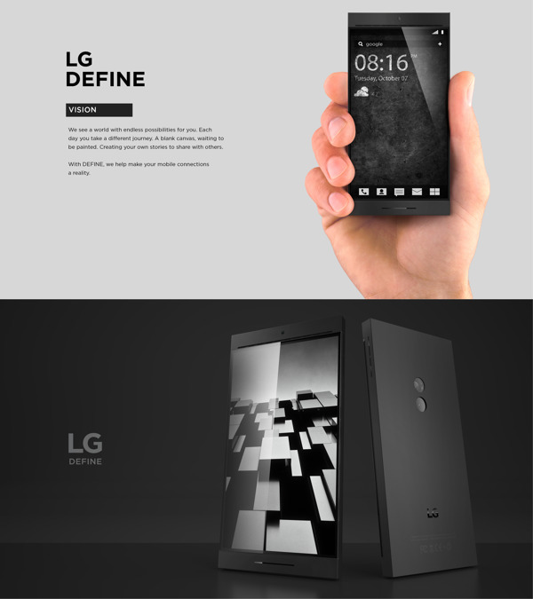](http://www.behance.net/gallery/LG-Define/6148491)

This leads me to my other idea of branding something like a museum. Museums often have a lot of print based branding and promotional material as it is a lot cheaper than other mediums. One particular museum that has a branding issue is Bletchley Park. This is a fascinating part of both the countries history and scientific innovation, however it’s branding is very dated and could be brought out into the public eye through the use of effective design.

[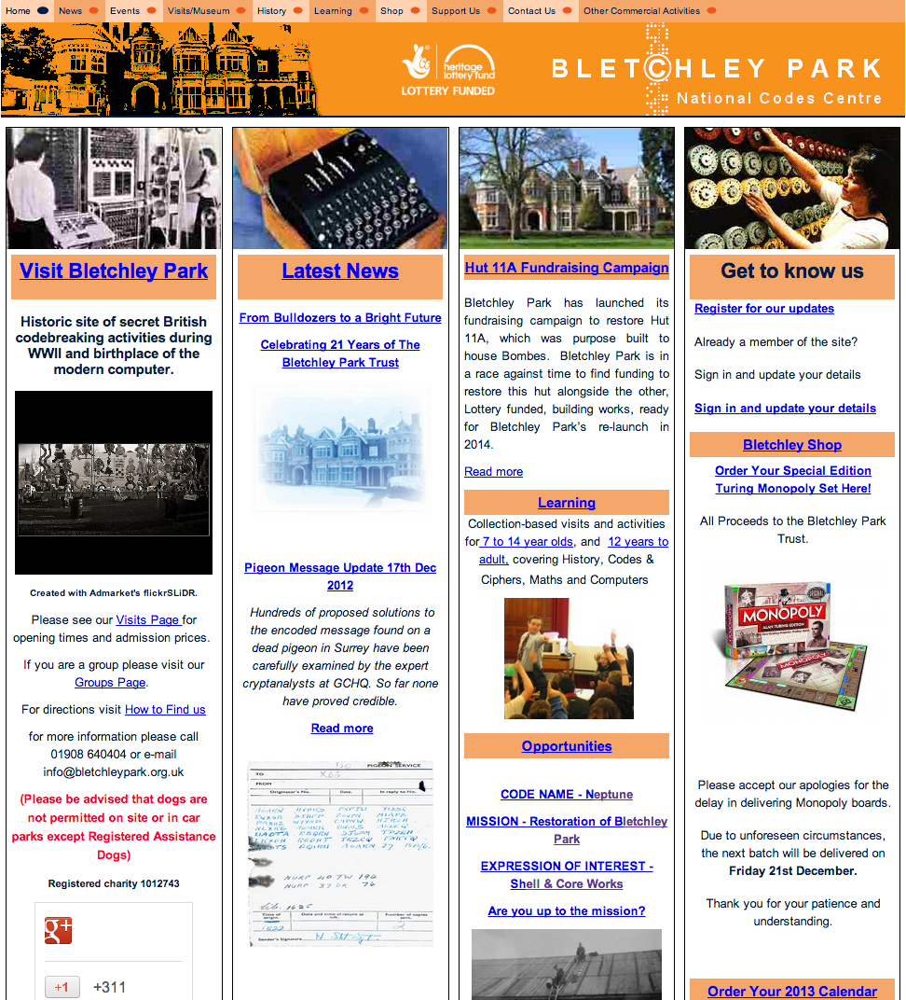](http://www.bletchleypark.org.uk/)

I then started looking at slightly more corporate branding design challenges and it was recommended I take a look at Saudia, a Saudi Arabian airline company. This particularly interested me as it would be challenging yet very rewarding to work with a brand that is both very different to what I am used to and would require developing skills in working with design in a foreign language. I was drawn to this after looking at some particularly eye catching designs combining traditional Arabic calligraphy and modern minimalist design.

[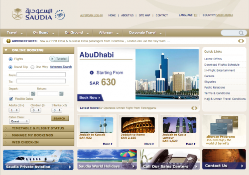](http://www.saudiairlines.com/)

The current Saudia website / branding

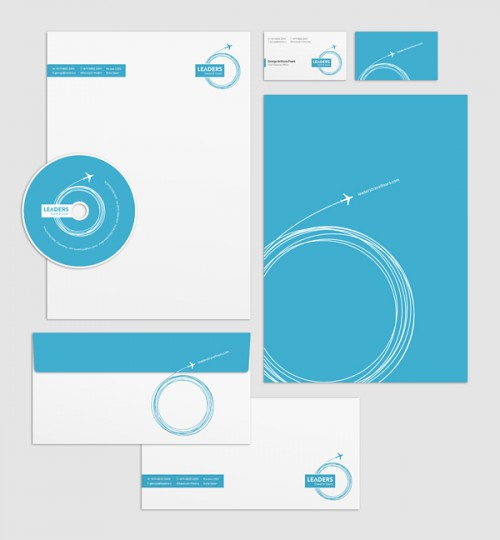

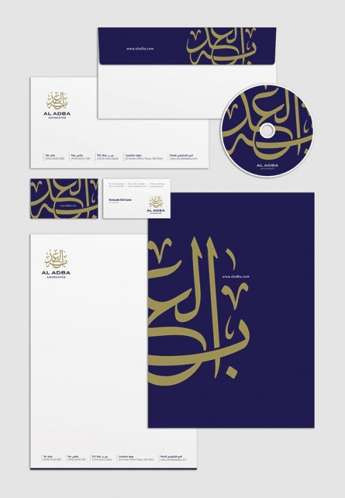

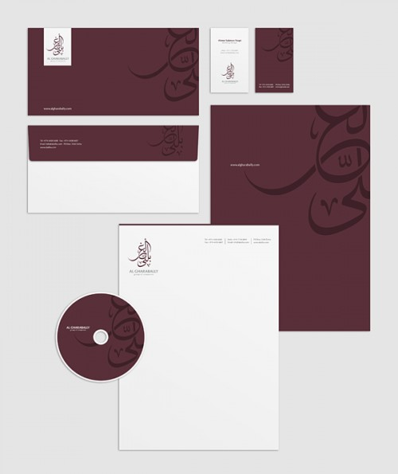

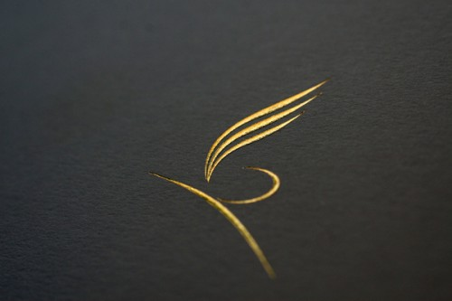

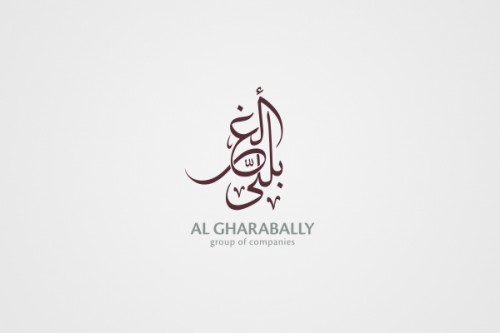

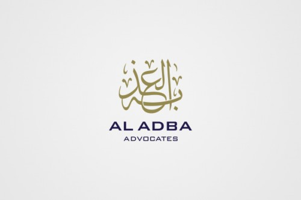

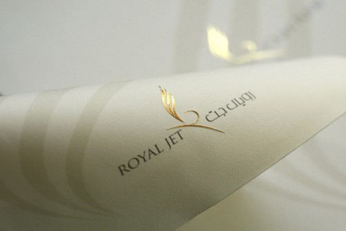

Some interesting use of Arabic Calligraphy in design and airline branding

I will continue to look at what route will be best to go down for my brief. Further understanding of the companies and how they operate will been to be carried out so I can find a weakness that my brief can address to effectively meet the assignment requirements.
