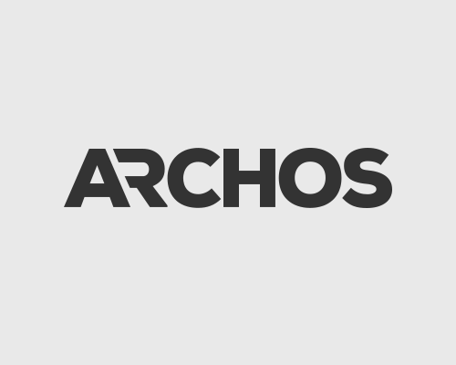
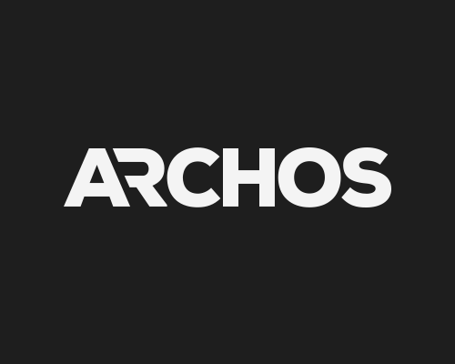
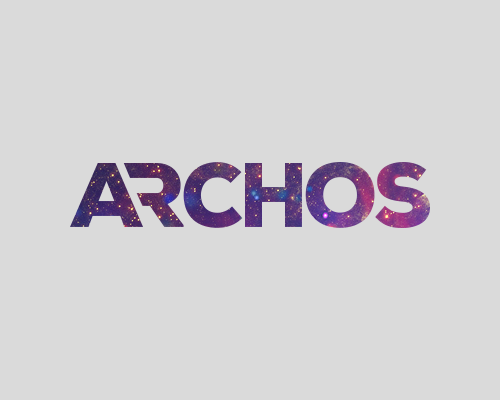

I have been developing a type logo to be used in the New Archos branding, I will need to develop the pictorial logo further. The logo is based on the corporate font family I have chosen called Nexa as this is a strong geometric typeface with many weights and fit very well with the image I wanted the brand to have. I initially wanted to use a variation on the DIN font but this was too costly. This is what I have of the logo so far and is still in development.

