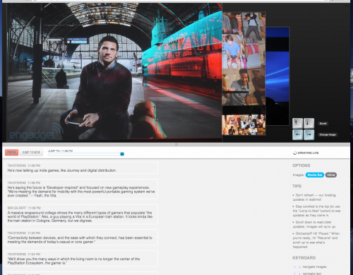
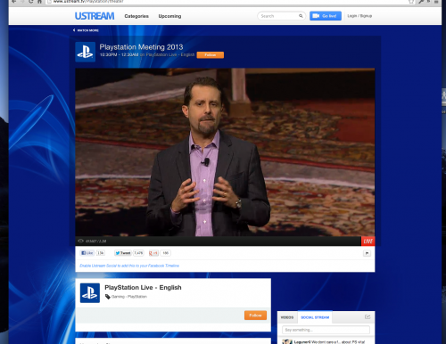
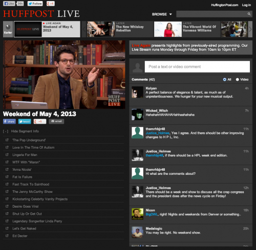

For some time now I have been looking at other ways websites incorporate live and social functionality into their own services. One such example which comes to mind is when Engadget, a technology news blog, covers important events in the technology sector such as big product announcements and launches. These can be seen during events like the announcement of a new Apple product or currently with the next generation videogame console announcements like Sony’s recent unveiling of the PlayStation 4.

Their approach is by having a constantly updated stream of photos at the top showing what is happening at the event being recorded in real time by reporters, and along side this there is a stream of textual updates and tweets from the different reporters either at the event or watching the coverage from somewhere else. This combination gives a good sense of ‘live’ coverage to what was once a particularly static event in the calendar, where reports would come after the announcement had finished.

Another way of watching this same event was through the many different streaming websites that allow broadcasts of many different things to be shown to a wide audience in real time. One example is Ustream, which is, as described on their website:

> … the world’s fastest-growing and largest live streaming platform … Our mission is to bring the world together by immersing viewers in live broadcasts that create riveting experiences, interactive communities…

It’s clear that the idea of social interaction and audience participation is a crucial element in this so it’s something I will also need to think about and look at implementing in my answer to the brief. Looking at the website we see a large video taking centre stage with information beneath and a social box with people communicating with each other during the event as it is happening. I have cropped it out mostly because it was filled with inane banter and foul language, something I will need to think about, perhaps adding a layer of security via an account and only allowing people to communicate within social groups.

This theme is also carried through into the Huffington Post’s Huff Post Live feature in which a live streaming video is shown along side, again, a social interaction widget where people can post textual and video content to participate in what is happening. This is showing a clear trend in what works at the moment in live web pages and their content.

However what these approches do lack is the concept of pages feeling live at all times, they are short-lived and are only ‘current’ during the event in question, leading me to think of other ways things can stay relevant regardless of whether you are joining in live or watching later on. I am looking towards having a BBC iPlayer-like page for each of their programmes where the video stream of that programme can be seen either live at the time or broadcast or later on like with iPlayer but because the page will be specific to that program it gives the possibility of tying together all the information and content of that show into on place or ‘hub’.

At the moment the iPlayer is simply a place to go and passively watch any show that has been on, but what I envisage is a place where people who are either fans or are generally interested in what ever the show might be where they can all socially interact with the content of the show and even participate with each other or even the show itself if it is a live show such as Stargazing Live with Brian Cox and Dara O’Briain.
