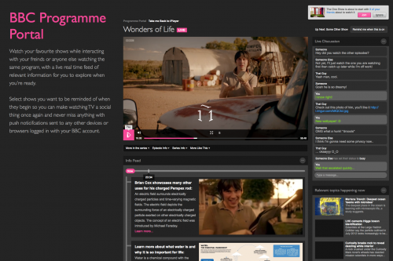

Focusing on one element of the BBC website, the individual programme webpages, I have developed the foundations of my idea to further my explanation of what it is I am setting out to achieve. I have been consolidating my research and personal experiences with the BBC’s and other’s services and decided up the concept of a ‘Programme Portal’.

This is essentially the website you go to which is specific to that programme and contains all the information about it, but it offers more that what it used to and much more than what the iPlayer can offer too. Since it’s isolated to each programme it means information about that specific show can be displayed there without worrying about cluttering up the iPlayer for example, but this also allows for people genuinely interested in the show to interact and participate at any level they wish.

This is my initial concept for my answer to the brief. Users will sign into their BBC account and be able to communicate with others watching the same show. Security measures will be in place to stop people from spamming or being unpleasant by letting the user choose how wide the scope is of their social communication of the messaging widget. For instance they can choose to turn it off, only talk to other friends contacts watching the show, or if they choose publicly chat with any participants of the show.

There will with other widgets showing relevant shows, news stories or information about the BBC about other of relating topics which allows for the audience to easily interact with the BBC’s extensive archive. This is backed up by one of the most prominent features, a timeline beneath the video player, much like the photo/tweet timeline from my research  this will show in real time during the programme wither related information, additional facts or things about the making of the show so that the audience is more involved with watching the show and if that want, are seeing a constant live feed of what’s happening on stream.

This will also be able to work later on when the show is no longer being broadcast live, so no matter when users view the content it will always feel live, and information in the ‘Live Feed’ will always pull in updated and relevant information from about the BBC such as news stories which happened after broadcast.

At a technical perspective this could theoretically be achieved by algorithms determining what is happening in the show at the specific time it is happening by referencing a transcript of dialogue or image matching of the video content and cross referencing with object and facial recognition.

Since the audience will be logged into an account which could be linked to other friends this allows for notifications to determine whether other people you know are wtahcing shows you like or shows you are also watching, linking them together so they can then intereact with eachother in real time, in the way you might if you were watching television together in the same room, but digitallt through the web, adding to the ‘live’ feeling.
