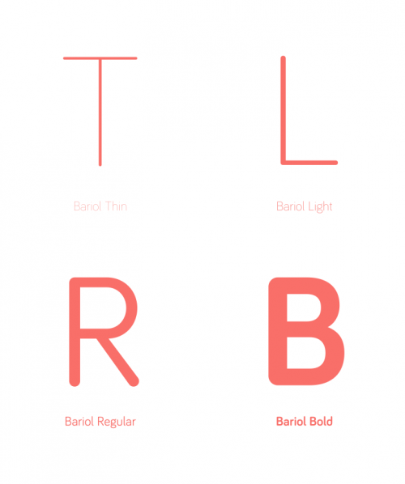
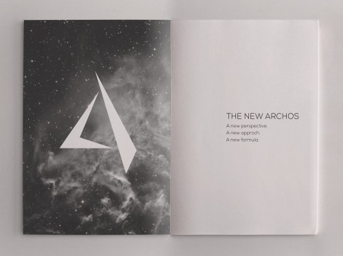
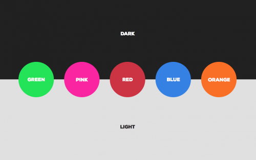
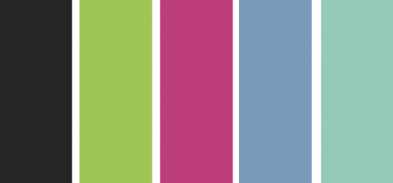

After the presentation of my work to the class and getting some critical feedback, of which I found very helpful, I went about thinking of solutions to the problems and how to implement them. I started off by thinking about what Mary had said about making it more ‘friendly’, which I found to be a good idea as my initial concepts had been very sharp and brash, with black and white imagery.

This could pose a problem as I want to relate to the audience and create a lasting rapport with them and to create a distinction for the brand which seems to be lacking somewhat in the technology sector. Some companies appear friendly and they do well so I wanted to go down that route. I started my changing the brand typefaces I had selected from very computer-y tech-y ones to something softer, rounded and more curved to create this tone.

I chose Bariol, a well designed and comprehensive font family that I felt could convey both technology and friendliness at the same time:

I then went to work on finding the perfect body copy typeface to be used on documents and stationary materials so I could start setting up the brand guidelines and getting some of the content ready. I was looking through some and noticed Gotham had very good shapes, at first I didn’t think it would be good at small sizes, but once I changed it to light and increased the leading it looked easy on the eye and good to read at 8pts which I felt was a good size for A4 size.

I did decide early on in the process that most of my content will be at A4 size as this will make it easier for my to manage and print things later on down the line for portfolio work. I came across many complications last year with the magazine, designing a different size which required A3 paper unless it was scaled down. I compromised on dimensions and stuff with A4 to keep things consistent and simple to manage.

The other changes I made were taking away the space and nebular theme from the overal general branding. I felt that this idea would be good only in say, an advertising campagin, as opposed to being an intrinsic element of the brand which could easily go out of style soon, I didn’t see it as a lasting aspect which could be used everywhere, and for that reason, I set it aside.

I also took the time to develop a better corporate colour palette as my initial attempts were dated and not very aesthetically pleasing, drawing on more basic colours rather than interesting tones. I looked at a great deal of many things, searching through my Behance and Dribbble favourites and noticed that cool and calming colours seemed to be a good direction, especially if I wanted to convey friendliness.

Still keeping with the branding I wanted the lime green to stay, however I changed the values slightly to make it a bit easier to the gaze of a human eye. I then developed some more highlight colours and one which could work well with the main lime green and went for a subtle hot pink to contrast with the green:

So the final colour palette is now 95% black, lime green, hot pink, blue and teal. These can be used throughout branding and each colour can act as a way of determining the status of something so that a hierarchy is formed from the colours used, however I will developed this further when it comes to creating the brand guidelines.
