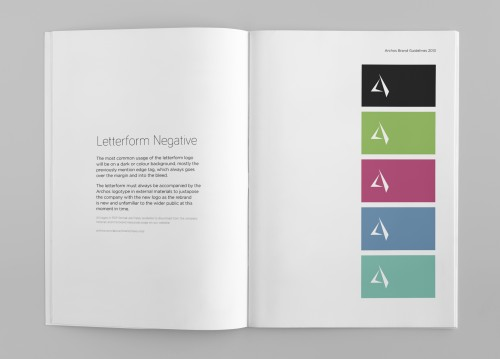
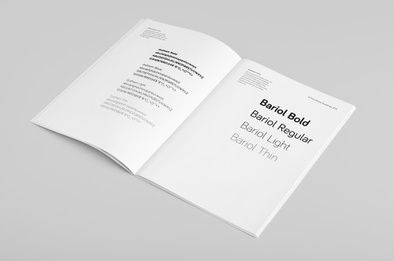
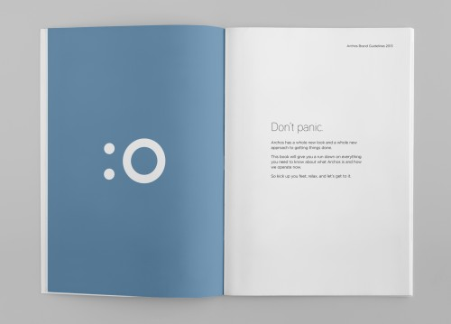
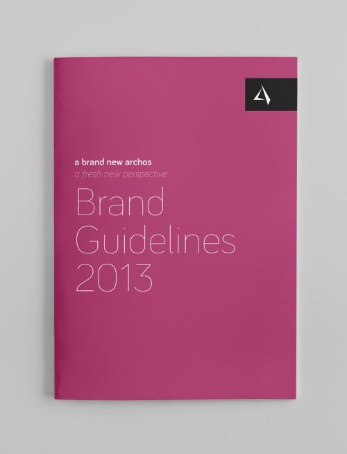
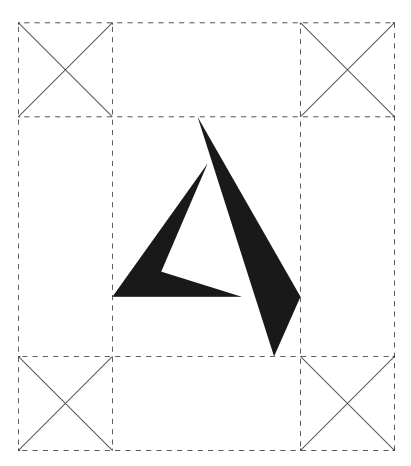
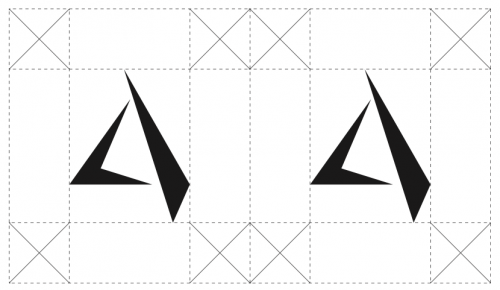
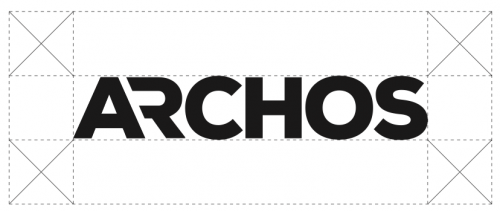

I have been developing the branding guidelines book to be used in the company as a general guide as to how things are done, how the one of the brand should be conveyed and what to do or not to do with things like the logo and so on. I took inspiration mostly from the Mediacom branding book Mary had given us at the start of the year as this was was a very good example of a comprehensive branding book. I had seen other examples of brand guidlines but a lot of them miss out on the crucual brand values and just focus on the imagery such and colour pallete and logos

I have spent the time to walk the user of the book through on the basic concepts of using logos, what each one is for and when and how to use the colour pallete for most effective and consistence use across any areas of print or digital design.

I have also laid down the ground rules for things like typooghraphy among the company and when that should be used as well. There are other factors to take into consideration as well such as web fonts, but I have kept web branding simple and opted for using Arial for most web body copy.

One of the concepts I want to bring across in the branding is the use of these emoticons, I have chosen to go with something whimsical and understated as the company creates tablet computers and smart phones. The users use these to communicate with each other in an often light hearted manner  so I went for using this concept in the branding as it conveys a light hearted friendliness to the audience.

I have been trying to make the brandin guidelines and comprehensive as possible so all the bases are covered, I have also developed the logo to a point where I feel it is complete. Also finishing the pictorial logo. An abstract A will now be the main logo, but als accompanied by the Archos logotype to give it juxtaposition and ground it to the brand.

From the page featuring the letterform logos I have decided the logo will be used on a tag, originally derived from looking a a pear of jeans and seeing the label was sticking ou ton the outside, with the brand on it, clearly indicating the brand was of such a status that the tag was on the outside instead of the inside. I took this simple concept and delviped the idea of showing the letterform on a tag which would reside on the edge of printed materials.

As can be seen in this example of the cover o the brand guidelines book, I have used the letterform as a negative in the dark grey tag, the tag will be determined by the exclusion zone of the logo and then doubled, this examples shows the mechanics of how it works.

This is an example of the letterform logo with it’s exclusion zone.

This is then double and thus dictates the size of the tag. Whichever side the tag resides is the one you use, the other is removed and a solid colour is applied to the size of the tag so that it can be used to stand out on advertising and publications easily and be noticeable.

This is an example of the exclusion zone for the logotype. The exclusion zone is there as a safeguard against putting the logo too closely to other things or against edges too far. The logo needs to stand out on it’s own and cannot be surrounded by clutter.
