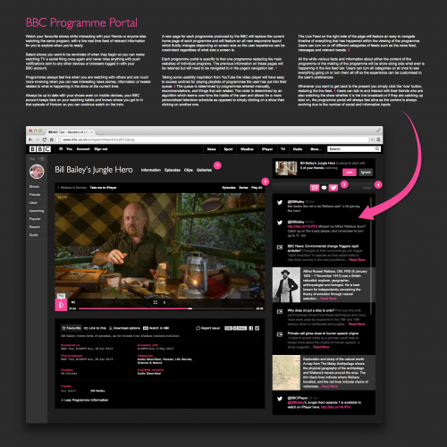
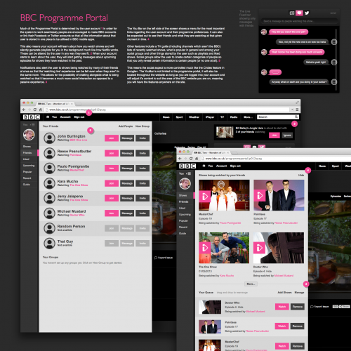

Leading up the the final deadline for the assignment I took some time in refining my concept as I did not intend on officially submitting it to D&AD due to the cost and my low confidence in my idea. I feel that it could have been stronger if I had more experience in thinking about interactive web solutions but because that is not my main area I found it rather difficult to both develop cohesive ideas at the initial stages of the project but also to think of ways they could be implemented not having experience in complex web applications.

If I could have changed anything, I would probably have chosen a brief that I felt more comfortable with as opposed to one which was simply to further my knowledge and experience in an area I didn’t already have much in as it was mostly based on the idea and concept rather than the actual product I created. I think that the overhead of not being entirely comfortable in the field factored heavily in my slow and unsure start at the beginning and ultimately my loss of interest in the overal solution I had come up with.

Choosing a much more fitting brief had become very apparently and I think was the crucial part in this project, if I had chosen perhaps an adversing or graphic design based brief I wouldn’t have had to worry more about the technical side of things and simply focused on the fundamental ideas and concepts which D&AD are mostly interested in. I would not say the project was a failure, but rather, could have gone much better. I have learnt a very valuable lesson in taking the time to choose something more suited to my skills and abilities.

I feel that for what I have achieved I am happy with the result as I initially found it rather difficult to communicate my concepts and ideas but have developed them to a point where they are easier to understand and visualise without having a working model. I did intend on putting together a working wireframe of the website, but the brief did not specify that was necessary so I decided against it as it would have been very time consuming (as I did not know how to use the wireframing software).

I also decided against making a video (either a video or image boards were accepted) as this would have, again, been very time consuming to put together without a working model of a functioning website to record and as I am not familiar with the Adobe After Effects software I was again discouraged by a lengthy learning process required to put together a comprehensive presentation of my idea.

I ended up refining my initial conceptual ideas and displaying them in a ways that should be familiar to users of other social web applications and also convey the solution for the brief effectively. I reworked the Live Feed bar to include tweets, news items, archive information, custom programme information and even messages. What the user sees in this bar is controlled by what elements they have turned on. So they can turn them all off, just have one or two turned on or all of them depending on what level of involvement they want to get.

I think this final version of my concept would work well with both live broadcasts of shows and also with factual programming as well, but the concepts would be worked into other genres of shows as well. I have focused on factual programming as I personally am interested in that genre and thus have catered to an audience similar to myself as I am comfortable with that area at least.
